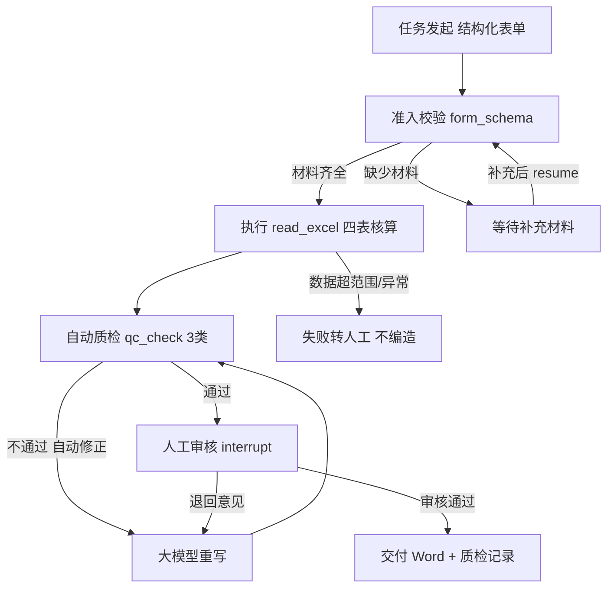

# 迷你数字员工——经营周报员工（场景 A）技术报告

## 1. 项目概述

本项目实现赛题"迷你数字员工"场景 A：**经营周报员工**。系统像一名新员工那样，读取门店销售数据与周会纪要，核算核心经营指标、识别异常波动、生成带图表的经营周报 Word，并在交付前接受人工审核；做得不对按审核意见返工，遇到缺材料或数据超出范围时暂停说明原因，而非编造结果或直接崩溃。

核心设计哲学：**流程骨架由程序"写死"把关（可控），但员工的"怎么干活"由 `employee.yaml` 配置驱动（灵活）**——这正好命中赛题评审四词"可控 / 可用 / 懂业务 / 工程素养"。

## 2. 系统架构图



- **控制层（写死、程序判定）**：`state_machine.py` 状态流转表 + `form_schema.py` 准入校验 + `gate.py` 工具白名单。
- **配置层（业务人员可改）**：`employee.yaml`——岗位职责、工作步骤、注意事项、异常阈值、模型 limits。
- **能力层（工具）**：`read_excel` / `read_text` / `call_llm` / `generate_word`，均显式入参/出参。
- **界面层**：`app.py`（Streamlit）——发起、执行可视化、审核、退回、交付、状态面板。

## 3. 状态流转表（须给出，非法流转拒绝）

| 当前状态 | 事件 | 下一状态 |
|---|---|---|
| 待发起 | 提交表单 | 准入校验中 |
| 准入校验中 | 材料齐全 | 执行中 |
| 准入校验中 | 缺少材料 | 等待补充材料 |
| 等待补充材料 | 补充材料 | 准入校验中 |
| 执行中 | 执行完成 | 自动质检中 |
| 执行中 | 异常中止转人工 | 失败转人工 |
| 自动质检中 | 质检通过 | 人工审核中 |
| 自动质检中 | 质检不通过 | 执行中（自动修正后重做） |
| 自动质检中 | 异常中止转人工 | 失败转人工 |
| 人工审核中 | 审核通过 | 已交付 |
| 人工审核中 | 审核退回 | 执行中（意见作为上下文重做） |
| 已交付 / 失败转人工 | — | 终态 |

`next_status()` 对未定义转移抛 `ValueError`，即"非法流转被拒绝"（赛题要求）。

## 4. 员工能力配置说明（`employee.yaml`，不写死代码）

赛题要求"岗位职责/步骤/注意事项须写成可读、可修改配置文件，业务人员不改代码即可调整"。本项目把**所有业务规则外置**：

- `steps`：员工工作步骤（业务可读、可改顺序/内容）。
- `constraints`：喂给大模型的提示词约束（如"不得编造""纪要没提写原因待核实"）。
- `anomaly_threshold: 10`：**异常波动阈值（%）写在配置里**——业务方/评委可在现场直接改这个值，员工不自行定义异常（对应 FDE"把模糊需求变可验收"）。
- `limits.max_rounds / timeout_seconds / min_words`：模型轮次与超时上限，**超限转人工**，理由在本报告第 7 节说明。
- `allowed_tools`：员工可调用工具白名单（工程加固越权拦截依据）。

## 5. 工具与自动质检

**工具（≥3，受控）**：`read_excel`（数据核算）、`read_text`（纪要）、`generate_word`（文档）、`make_chart`（图表，内置于 read_excel）。每个工具入参/出参显式；`gate.py` 校验工具名是否在 `allowed_tools`，越权调用被拒绝并 `logging` 留痕（工程加固加分）。

**自动质检（≥3 类）**：`qc_check.py`
1. **字数**：正文 ≥ `min_words`（默认 300）。
2. **结构**：必须含六章节（摘要/核心指标/异常/品类/数据质量/下周关注）。
3. **数据一致性**：总实收、毛利率、外卖占比、各区域实收必须出现在正文，防止编造。
不通过则把质检原因反馈大模型自动修正后重试；重试达 `max_rounds` 仍失败 → 转人工。质检结果写入 `qc_logs` 随交付保存。

## 6. 数据核算口径（严格对齐《数据说明》《周报格式要求》）

读取 `销售明细.xlsx` 的 **4 个工作表**联合核算：销售明细（按门店编码 join 门店信息得区域、join 商品信息得品类）、销售目标（区域×周目标）。

- 实收 = 实收金额合计（退货为负自动冲减）；毛利 = 实收 − 成本；毛利率 = 毛利 ÷ 实收
- 环比 =（本周 − 上周）÷ 上周（上周数据同在表内，按周次过滤）
- 目标达成率 = 本周区域实收 ÷ 销售目标表对应区域/周目标
- 外卖占比 = 外卖渠道实收 ÷ 全部实收
- 异常 = 区域/门店环比波动 ≥ `anomaly_threshold`（默认 10%）
- 数据质量：退货笔数/金额、记录ID 重复去重、整周零销售门店、新开门店、数据覆盖范围
- **数据超出覆盖范围（如第 46 周，数据只到 W44）→ 直接暂停并说明，绝不输出该周数字**

**与赛题公开样例用例逐项吻合**（节选 A-01 / W44）：

| 指标 | 样例判定 | 系统核算 |
|---|---|---|
| 全公司实收 / 环比 / 毛利率 / 外卖占比 | 573,635 / -9.3% / 61.1% / 31.8% | 573,635 / -9.3% / 61.1% / 31.8% ✓ |
| 华东 / 华南 / 华北 / 西南 实收 | 197,618 / 177,306 / 119,712 / 78,998 | 完全一致 ✓ |
| 异常门店（±10%） | 杭州湖滨-38.3 等 4 家 | 4 家完全一致 ✓ |
| 退货 | 11 笔 -260 元 | 11 笔 -260 元 ✓ |

A-02（去重 29 条/5,629 元）、A-04（退货 15 笔/-656 元）、A-05（W46 超范围暂停）同样吻合。

## 7. 模型调用上限取值理由（`employee.yaml → limits`）

- `max_rounds: 8`：周报需"生成→质检→修正"多轮往返，且审核退回会再触发重写；8 轮足以覆盖正常修正，又防止无限循环。
- `timeout_seconds: 120`：大模型生成中文长文（含表格与多章节）常需 30–90s，60s 偏短易误判超时；120s 留足余量。
- `min_words: 300`：低于此正文过短无法覆盖六章节，但又不机械拉字数（格式要求正文不超 3 页）。

## 8. 评审重点对应（可控 / 可用 / 懂业务 / 工程素养）

- **可控**：关键控制（能否进入审核/交付、非法流转）由 `state_machine` 程序判定；缺料/超范围/超限均暂停说明，不编造。
- **可用**：交付物直接是运营部要的 Word（六章节 + ≥2 图表 + 整数金额 + 1 位小数），数字可溯源到数据核算面板。
- **懂业务**：异常阈值、验收指标由配置与界面明示；审核页支持退回意见注入重做（human-in-the-loop 的"留活口"）。
- **工程素养**：代码结构清晰（控制/配置/工具/界面分层）、`employee.yaml` 可读可改、`pytest` 测试、Git 提交记录、一键运行 README。
- **现场变更敏捷**：评委临时改需求（如"阈值改成 5%"）→ 只改 `employee.yaml` 重跑即过。

## 9. 复现步骤

```bash
pip install -r requirements.txt
cp .env.example .env        # 填入 DEEPSEEK_API_KEY
python main.py              # 浏览器打开后：填周期(如2026年第44周)+上传销售明细.xlsx+周会纪要.docx
```
界面依次：发起 → 自动核算与生成 → 查看"指标核算与异常判定"面板 → 提交人工审核 → 通过交付 / 退回重写。

## 10. 竞赛辅导录音建议的落地

辅导中评审强调的要点，本项目已逐一落实：
1. **"异常/风险不能让大模型定，要人定、可现场改"** → `anomaly_threshold` 配置化，演示时可当场改值重算。
2. **"推理过程/可解释性要可视化"** → 界面"指标核算与异常判定"面板展示全部核算数字与异常判定来源，评委问到可当场讲清。
3. **"human-in-the-loop 留活口，支持人工修改判定"** → 审核页"退回修改"把意见作为上下文重做；必要时人工兜底强制交付。
4. **"从业务方角度讲价值"** → 交付物严格对齐运营部《周报格式要求》，而非"能跑就行"。
